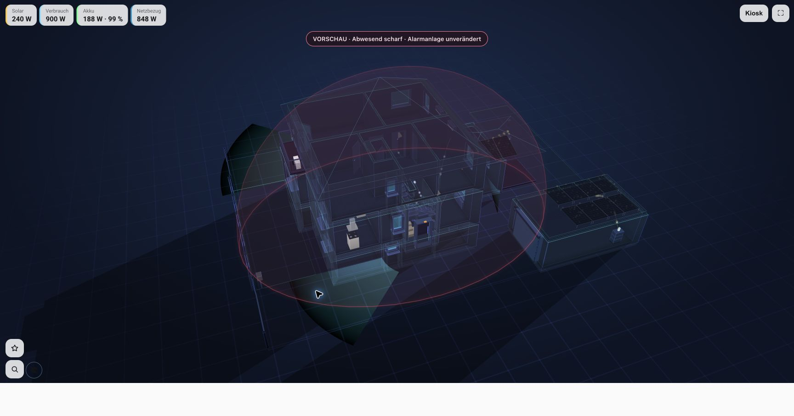

# Schutzschild für NextFloor und Alarmo

Die Idee war einfach: Wenn die Alarmanlage scharf ist, soll man das am ganzen Haus sehen – als leicht schimmernden Schutzschild statt nur als kleines Symbol.

Dieses Plugin legt dafür eine transparente Kuppel um dein Haus in [NextFloor](https://github.com/therealMRBK/NextFloor). Sie folgt der Ansicht beim Drehen und Zoomen. Gedacht ist es für [Alarmo](https://github.com/nielsfaber/alarmo); grundsätzlich funktioniert es auch mit anderen Home-Assistant-Alarmanlagen.



*Der Screenshot zeigt die Vorschau. Die echte Alarmanlage war dabei unscharf.*

Ist die Anlage **scharf**, schimmert die Kuppel dezent rot. Während der **Ein- oder Ausgangsverzögerung** wird sie orange. Bei **ausgelöstem Alarm** pulsiert sie stärker rot. Ist die Anlage unscharf oder ihr Zustand unbekannt, verschwindet der Schild.

Farbe, Stärke und Pulsieren lassen sich einstellen. Wer mag, kann ein Energiegitter anzeigen oder eine freistehende Garage mit einschließen. Zum Ausprobieren gibt es eine klar markierte **30-Sekunden-Vorschau**. Das Plugin schaltet die Alarmanlage niemals selbst scharf oder unscharf.

## Einrichten

1. [Die Plugin-Datei herunterladen](https://raw.githubusercontent.com/alex1255/nextfloor-alarmo-shield/93f81b843df86d9b878373fb6e7732c68e046f09/nextfloor-alarmo-shield.js) und in Home Assistant unter `/config/www/nextfloor/alarm-shield/nextfloor-alarmo-shield-1.0.1.js` ablegen. Fehlende Ordner vorher anlegen.
2. In NextFloor unter **Erweiterungen → Plugins** diese Adresse hinzufügen: `/local/nextfloor/alarm-shield/nextfloor-alarmo-shield-1.0.1.js`.
3. Die Alarmanlage im NextFloor-Editor platzieren und bei ihren Geräteeinstellungen **Alarm-Schutzschild** aktivieren. Eine Einstellung speichern, damit diese Alarmanlage dem Schild zugeordnet wird.
4. Die Seite neu laden und die Haus-Gesamtansicht öffnen.

Für den bequemen Zugriff im Sternmenü einen eigenen Knopf **Schutzschild** mit der Aktion `fire_dom_event` und diesen Daten anlegen:

```json
{"nextfloor_shield":{"action":"settings"}}
```

Darüber öffnest du Einstellungen und Vorschau. Die Einstellungen werden im Plan gespeichert. Die Einrichtung braucht keinen Fork von NextFloor; das Plugin läuft lokal und benötigt keine Cloud-Verbindung.

## Was man wissen sollte

Getestet mit **NextFloor 0.24.0**, Plugin-API 1. Für die Kuppel nutzt das Plugin einen kleinen Adapter zur NextFloor-Kamera. Es verändert keine NextFloor-Programmdateien, kann bei größeren Änderungen an der Ansicht aber eine Anpassung brauchen. Die Kuppel ist eine projizierte Einblendung und kein physikalisch exakt verdecktes 3D-Objekt.

Die [technischen Hinweise](docs/TECHNICAL.md) erklären das genauer. Zehn Tests prüfen unter anderem Alarmzustände, Projektion und Hausgeometrie. Ausführen mit `npm test`; keine zusätzlichen Pakete nötig.

MIT-Lizenz. Ein unabhängiges Community-Plugin, kein offizieller Bestandteil von NextFloor oder Alarmo.
