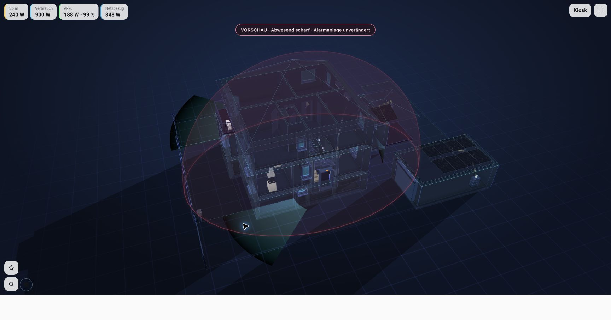

# Schutzschild für NextFloor und Alarmo

Die Idee war einfach: Wenn die Alarmanlage scharf ist, soll man das am ganzen Haus sehen – als leicht schimmernden Schutzschild statt nur als kleines Symbol.

Dieses Plugin legt dafür eine transparente Schutzhülle um dein Haus in [NextFloor](https://github.com/therealMRBK/NextFloor). Sie folgt der Ansicht beim Drehen und Zoomen. Gedacht ist es für [Alarmo](https://github.com/nielsfaber/alarmo); grundsätzlich funktioniert es auch mit anderen Home-Assistant-Alarmanlagen.



*Der Screenshot zeigt die Vorschau. Die echte Alarmanlage war dabei unscharf.*

Ist die Anlage **scharf**, schimmert der Schild dezent rot. Während der **Ein- oder Ausgangsverzögerung** wird er orange. Bei **ausgelöstem Alarm** pulsiert sie stärker rot. Ist die Anlage unscharf oder ihr Zustand unbekannt, verschwindet der Schild.

Farbe, Stärke und Pulsieren lassen sich einstellen. Unter **Form** kannst du zwischen **Kuppel** und **Kugel** wählen. Die Kugel schließt den Keller ein und läuft darunter weiter. Die Kuppel bleibt voreingestellt. Wer mag, kann ein Energiegitter anzeigen oder eine freistehende Garage mit einschließen. Zum Ausprobieren gibt es eine klar markierte **30-Sekunden-Vorschau**. Das Plugin schaltet die Alarmanlage niemals selbst scharf oder unscharf.

## Einrichten

### Plugin installieren

Am einfachsten geht es in NextFloor über **Erweiterungen → Plugin-Store**. Dort nach **Alarm-Schutzschild** suchen und das Plugin installieren. Danach die NextFloor-Seite neu laden.

Wer die Datei lieber selbst ablegt, kann die [Plugin-Datei herunterladen](https://raw.githubusercontent.com/alex1255/nextfloor-alarmo-shield/main/nextfloor-alarmo-shield.js) und unter `/config/www/nextfloor/alarm-shield/nextfloor-alarmo-shield-1.1.0.js` speichern. Fehlende Ordner vorher anlegen. Anschließend unter **Erweiterungen → Plugins** die Adresse `/local/nextfloor/alarm-shield/nextfloor-alarmo-shield-1.1.0.js` hinzufügen und die Seite neu laden.

### Die Alarmanlage zuordnen

Alarmo ist optional. Das Plugin liest eine Home-Assistant-Entität aus der Domain `alarm_control_panel`. Auch bei einer anderen Anlage, etwa Ring, muss eine solche Entität vorhanden sein. Ihre genaue Entitäts-ID findest du in Home Assistant unter **Entwicklerwerkzeuge → Zustände**, wenn du nach `alarm_control_panel.` suchst. Die Ring-Anbindung selbst ist nicht Bestandteil dieses Plugins.

1. Den **NextFloor-Editor** öffnen.
2. Die Alarmanlage mit ihrer `alarm_control_panel.…`-Entität im Grundriss platzieren. Ist sie bereits platziert, diese auswählen.
3. In den Geräteeinstellungen den Abschnitt **Alarm-Schutzschild** öffnen.
4. **Schutzschild aktiv** einschalten und die gewünschten Einstellungen festlegen. Mindestens eine Einstellung speichern, damit die Zuordnung im Plan hinterlegt wird.
5. Die NextFloor-Seite neu laden und die **3D-Gesamtansicht des Hauses** öffnen. Voreingestellt ist der Schild nur dort sichtbar.
6. Sobald die zugeordnete Anlage scharf ist, erscheint der Schild. Bei unscharfer Anlage bleibt er ausgeblendet.

Für eine Vorschau lässt sich im Raum-Panel der Alarmanlage der Knopf **Schutzschild: Einstellungen und Vorschau** nutzen. Im Dialog kannst du mit **Scharf ansehen** den Schild für 30 Sekunden ausprobieren.

### Optionaler Knopf im Sternmenü

Ein Knopf im Sternmenü wird bei der Installation nicht automatisch angelegt. Wenn du ihn möchtest, kannst du dort einen eigenen Knopf **Schutzschild** mit der Aktion `fire_dom_event` und diesen Daten hinzufügen.

```json
{"nextfloor_shield":{"action":"settings"}}
```

Darüber öffnest du ebenfalls Einstellungen und Vorschau. Mit **Im Plan speichern** werden die Einstellungen dauerhaft hinterlegt. Das Plugin läuft lokal und benötigt keine Cloud-Verbindung.

## Was man wissen sollte

Getestet mit **NextFloor 0.24.0**, Plugin-API 1. Für den Schild nutzt das Plugin einen kleinen Adapter zur NextFloor-Kamera. Es verändert keine NextFloor-Programmdateien, kann bei größeren Änderungen an der Ansicht aber eine Anpassung brauchen. Der Schild ist eine projizierte Einblendung und kein physikalisch exakt verdecktes 3D-Objekt.

Die [technischen Hinweise](docs/TECHNICAL.md) erklären das genauer. Elf Tests prüfen unter anderem Alarmzustände, Projektion und Hausgeometrie. Ausführen mit `npm test`; keine zusätzlichen Pakete nötig.

MIT-Lizenz. Ein unabhängiges Community-Plugin, kein offizieller Bestandteil von NextFloor oder Alarmo.
